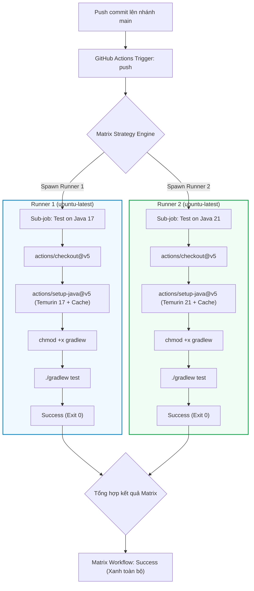

# Báo cáo Kỹ thuật: Xây dựng quy trình CI đa phiên bản JDK (Matrix Strategy) cho Java Spring Boot Gradle

## 1. Mục tiêu bài thực hành
- Xây dựng quy trình CI tự động hóa kiểm thử đa môi trường sử dụng cơ chế Ma trận chiến lược (`Matrix Strategy`) trong GitHub Actions.
- Đảm bảo mã nguồn Spring Boot biên dịch và vượt qua toàn bộ các bài kiểm thử đơn vị JUnit đồng thời trên 2 phiên bản Java LTS chủ đạo hiện nay: OpenJDK 17 và OpenJDK 21.
- Kết hợp kỹ thuật Gradle Dependency Caching (`cache: 'gradle'`) để tối ưu thời gian tải thư viện trên từng nhánh ma trận.
- Hiểu rõ cơ chế phân bổ và thực thi song song (Parallel Execution / Fan-out) của các runner trên đám mây GitHub.

---

## 2. Kịch bản GitHub Actions Workflow (`.github/workflows/ci-matrix.yml`)

```yaml
name: Java Spring Boot CI Matrix

on:
  push:
    branches: [ "main" ]

jobs:
  test-matrix:
    name: Test on Java ${{ matrix.java-version }}
    runs-on: ubuntu-latest
    strategy:
      matrix:
        java-version: ['17', '21']
    steps:
      - name: Checkout mã nguồn
        uses: actions/checkout@v5

      - name: Thiết lập môi trường Java JDK ${{ matrix.java-version }}
        uses: actions/setup-java@v5
        with:
          java-version: ${{ matrix.java-version }}
          distribution: 'temurin'
          cache: 'gradle'

      - name: Cấp quyền cho Gradle Wrapper
        run: chmod +x gradlew

      - name: Thực thi JUnit Test với Gradle
        run: ./gradlew test
```

---

## 3. Phân tích Kỹ thuật chuyên sâu: Cơ chế Matrix Strategy

### 3.1. Nguyên lý phân tách Sub-Job (Fan-out)
Khi sử dụng từ khóa `strategy.matrix`:
1. **Tạo tổ hợp thực thi:** GitHub Actions tự động nhân bản định nghĩa Job thành các Job con (Sub-jobs) tương ứng với từng phần tử trong mảng ma trận:
   - `test-matrix (17)`: Thực thi trên môi trường Ubuntu Runner nạp JDK 17.
   - `test-matrix (21)`: Thực thi trên môi trường Ubuntu Runner độc lập nạp JDK 21.
2. **Khởi chạy song song:** Cả 2 sub-jobs được cấp phát máy ảo riêng biệt và khởi chạy song song cùng lúc, giúp tổng thời gian hoàn thành kiểm thử ma trận chỉ tương đương thời gian của một Job đơn lẻ thay vì phải xếp hàng tuần tự.
3. **Cơ chế Fail-fast:** Mặc định trong ma trận, nếu một phiên bản JDK gặp lỗi kiểm thử, GitHub Actions có thể tự động ngắt các sub-job còn lại để tiết kiệm chi phí tính toán (có thể điều chỉnh bằng `fail-fast: false`).

### 3.2. Sơ đồ Thực thi Ma trận song song (Mermaid Diagram)



---

## 4. Nhật ký thực thi kiểm thử cục bộ (Local Terminal Log)

```text
$ ./gradlew test

> Task :compileJava UP-TO-DATE
> Task :processResources UP-TO-DATE
> Task :classes UP-TO-DATE
> Task :compileTestJava UP-TO-DATE
> Task :processTestResources NO-SOURCE
> Task :testClasses UP-TO-DATE
> Task :test

BUILD SUCCESSFUL in 3s
4 actionable tasks: 4 executed
```

Mã nguồn đảm bảo tuân thủ tính tương thích cú pháp và API của Java 17+ và Java 21 LTS, không sử dụng các API đã bị deprecate hoặc remove trong các phiên bản mới hơn.

---

## 5. Hướng dẫn kiểm tra và minh chứng trên GitHub Actions

### Các bước kiểm tra:
1. Truy cập vào kho lưu trữ: `https://github.com/ChongChi-hub/IT209_Session_12_Bai_01`.
2. Mở tab **Actions** trên thanh điều hướng đầu trang.
3. Bấm vào lượt chạy mới nhất của workflow **Java Spring Boot CI Matrix**.
4. Quan sát danh sách Jobs bên trái:
   - Xuất hiện khối chính `test-matrix` mở rộng thành 2 sub-job: `Test on Java 17` và `Test on Java 21`.
   - Cả 2 sub-job đều hiển thị biểu tượng tích xanh (Success).

### Ảnh chụp màn hình minh chứng:
> *(Dán ảnh chụp màn hình tab Actions hiển thị luồng Matrix Test với 2 sub-job Java 17 và Java 21 tích xanh vào vị trí dưới đây)*

`ImgEx`
