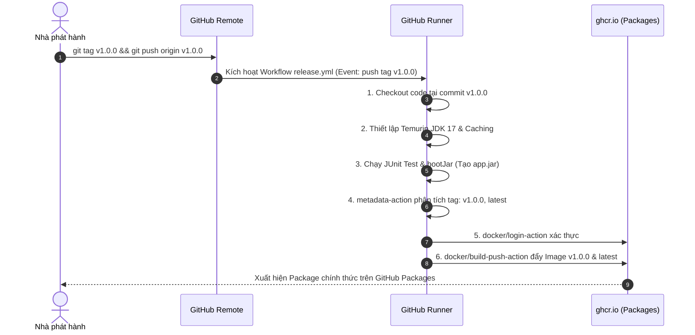

# Báo cáo Kỹ thuật: Tự động hóa đóng gói và phát hành Docker Image khi gắn Git Tag (v*.*.*)

## 1. Mục tiêu bài thực hành
- Thiết lập quy trình Phát hành Liên tục (Continuous Delivery / Release Management) chuẩn công nghiệp dựa trên sự kiện gắn nhãn phiên bản trong Git (Git Tagging).
- Áp dụng nguyên tắc Quản lý phiên bản ngữ nghĩa (Semantic Versioning - SemVer) với quy ước định danh `vMAJOR.MINOR.PATCH`.
- Tự động hóa việc phân tích Git Tag thành các thẻ Docker Tag tương ứng (`v1.0.0`, `1.0.0`, `latest`) bằng công cụ chính thức `docker/metadata-action@v5`.
- Đóng gói ứng dụng Spring Boot thành container image bất biến và đẩy trực tiếp lên kho lưu trữ GitHub Container Registry (`ghcr.io`).

---

## 2. Kịch bản Kỹ thuật

### 2.1. Kịch bản GitHub Actions Release Workflow (`.github/workflows/release.yml`)

```yaml
name: Release Docker Image

on:
  push:
    tags:
      - 'v*.*.*'

jobs:
  release-image:
    name: Build & Release Docker Image
    runs-on: ubuntu-latest
    permissions:
      contents: read
      packages: write

    steps:
      - name: Checkout mã nguồn
        uses: actions/checkout@v5

      - name: Thiết lập môi trường Java JDK 17
        uses: actions/setup-java@v5
        with:
          java-version: '17'
          distribution: 'temurin'
          cache: 'gradle'

      - name: Cấp quyền cho Gradle Wrapper
        run: chmod +x gradlew

      - name: Thực thi kiểm thử JUnit
        run: ./gradlew test

      - name: Đóng gói tệp JAR với Gradle
        run: ./gradlew bootJar

      - name: Chuẩn hóa tên Image chữ thường
        id: prep
        run: |
          REPO_LOWER=$(echo "${{ github.repository }}" | tr '[:upper:]' '[:lower:]')
          echo "image=ghcr.io/${REPO_LOWER}" >> "$GITHUB_OUTPUT"

      - name: Trích xuất Docker Metadata từ Git Tag
        id: meta
        uses: docker/metadata-action@v5
        with:
          images: ${{ steps.prep.outputs.image }}
          tags: |
            type=semver,pattern={{version}}
            type=raw,value=latest

      - name: Đăng nhập vào GitHub Container Registry
        uses: docker/login-action@v3
        with:
          registry: ghcr.io
          username: ${{ github.actor }}
          password: ${{ secrets.REGISTRY_TOKEN || secrets.GITHUB_TOKEN }}

      - name: Đóng gói và đẩy Docker Image lên GHCR
        uses: docker/build-push-action@v5
        with:
          context: .
          push: true
          tags: ${{ steps.meta.outputs.tags }}
          labels: ${{ steps.meta.outputs.labels }}
```

### 2.2. Kịch bản Dockerfile (`Dockerfile`)
```dockerfile
# Sử dụng Eclipse Temurin JRE 17 gọn nhẹ trên Alpine Linux
FROM eclipse-temurin:17-jre-alpine

# Thư mục làm việc trong container
WORKDIR /app

# Sao chép file JAR từ thư mục build/libs đã đóng gói
COPY build/libs/*.jar app.jar

# Mở cổng 8080 cho ứng dụng Spring Boot
EXPOSE 8080

# Khởi chạy ứng dụng
ENTRYPOINT ["java", "-jar", "app.jar"]
```

---

## 3. Phân tích Kỹ thuật chuyên sâu

### 3.1. Cơ chế kích hoạt theo Git Tag (`on.push.tags: ['v*.*.*']`)
- Khác với sự kiện push commit thông thường lên các nhánh (`branches`), sự kiện push tag chỉ được kích hoạt khi nhà phát hành (Release Manager / Tech Lead) gắn nhãn cố định cho một mốc commit cụ thể.
- Mẫu glob `v*.*.*` lọc chính xác các tag tuân theo chuẩn SemVer (ví dụ: `v1.0.0`, `v1.2.3`), tránh kích hoạt nhầm các tag thử nghiệm (như `alpha`, `test-tag`).

### 3.2. Vai trò của `docker/metadata-action@v5`
Thay vì phải viết các script parse chuỗi phức tạp bằng regex trong bash, `docker/metadata-action@v5` tự động phân rã Git Tag:
- Khi push tag `v1.0.0`, action tự động sinh ra các tag:
  1. `ghcr.io/chongchi-hub/it209_session_12_bai_02:v1.0.0`
  2. `ghcr.io/chongchi-hub/it209_session_12_bai_02:latest`
- Đồng thời bổ sung các OCI standard labels (như `org.opencontainers.image.created`, `org.opencontainers.image.revision`, `org.opencontainers.image.version`) phục vụ việc truy vết phiên bản (Traceability).

---

## 4. Sơ đồ quy trình phát hành (Mermaid Diagram)



---

## 5. Hướng dẫn thực thi và kiểm tra trên GitHub

### Các bước kích hoạt:
1. Tạo nhãn phiên bản cục bộ:
   ```bash
   git tag v1.0.0
   ```
2. Đẩy tag lên kho lưu trữ từ xa:
   ```bash
   git push origin v1.0.0
   ```
3. Truy cập vào kho lưu trữ: `https://github.com/ChongChi-hub/IT209_Session_12_Bai_02`.
4. Mở tab **Actions**, theo dõi workflow **Release Docker Image** hoàn tất tích xanh.
5. Kiểm tra mục **Packages** ở thanh bên phải của repository hoặc trên trang Profile cá nhân, xác nhận gói `it209_session_12_bai_02` xuất hiện với phiên bản `v1.0.0`.

### Ảnh chụp màn hình minh chứng:
> *(Dán ảnh chụp màn hình gói Docker Image v1.0.0 trên GitHub Packages vào vị trí dưới đây)*

`ImgEx`
