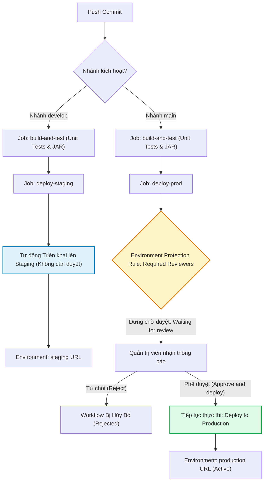

# Báo cáo Kỹ thuật: Tách biệt luồng CI/CD đa môi trường (Staging & Production) với GitHub Environments

## 1. Mục tiêu bài thực hành
- Quản trị hạ tầng phân phối phần mềm đa tầng (Multi-tier Deployment Architecture) thông qua tính năng GitHub Environments.
- Thiết lập ranh giới cách ly tài nguyên và bí mật (Environment Isolation) giữa môi trường thử nghiệm tiền phát hành (Staging) và môi trường vận hành thực tế (Production).
- Áp dụng cổng kiểm soát chất lượng (Deployment Protection Rules) với chính sách yêu cầu phê duyệt thủ công (`Required reviewers`) trước khi cho phép mã nguồn được nạp vào môi trường Production.
- Tự động hóa điều phối luồng CD dựa trên nhánh mã nguồn (`develop` triển khai tự động lên Staging; `main` kích hoạt quy trình phê duyệt lên Production).

---

## 2. Kịch bản GitHub Actions Workflow (`.github/workflows/cd-multi-env.yml`)

```yaml
name: Multi-Environment CD Pipeline

on:
  push:
    branches: [ "main", "develop" ]

jobs:
  build-and-test:
    name: Build & Run Unit Tests
    runs-on: ubuntu-latest

    steps:
      - name: Checkout mã nguồn
        uses: actions/checkout@v5

      - name: Thiết lập môi trường Java JDK 17
        uses: actions/setup-java@v5
        with:
          java-version: '17'
          distribution: 'temurin'
          cache: 'gradle'

      - name: Cấp quyền cho Gradle Wrapper
        run: chmod +x gradlew

      - name: Thực thi Unit Test với Gradle
        run: ./gradlew test

      - name: Đóng gói tệp JAR với Gradle
        run: ./gradlew bootJar

  deploy-staging:
    name: Deploy to Staging
    needs: build-and-test
    runs-on: ubuntu-latest
    if: github.ref == 'refs/heads/develop'
    environment:
      name: staging
      url: https://staging.ptit.example.com
    steps:
      - name: Checkout mã nguồn
        uses: actions/checkout@v5

      - name: Triển khai tới môi trường Staging
        run: |
          echo "Triển khai phiên bản thử nghiệm lên Staging Server..."
          echo "Môi trường: staging"
          echo "Commit SHA: ${{ github.sha }}"

  deploy-prod:
    name: Deploy to Production
    needs: build-and-test
    runs-on: ubuntu-latest
    if: github.ref == 'refs/heads/main'
    environment:
      name: production
      url: https://api.prod.example.com
    steps:
      - name: Checkout mã nguồn
        uses: actions/checkout@v5

      - name: Triển khai tới môi trường Production
        run: |
          echo "Triển khai phiên bản chính thức lên Production Cluster..."
          echo "Môi trường: production"
          echo "Đã xác thực và phê duyệt bởi Quản trị viên!"
          echo "Commit SHA: ${{ github.sha }}"
```

---

## 3. Phân tích Kỹ thuật chuyên sâu

### 3.1. Giá trị của GitHub Environments trong Quản trị DevOps
- **Bảo mật theo ngữ cảnh:** Mỗi environment có thể lưu trữ bộ Secrets và Variables riêng biệt (ví dụ: `DATABASE_URL` của Staging trỏ vào database test, trong khi `DATABASE_URL` của Production trỏ vào cluster có tính khả dụng cao).
- **Deployment URL & Lịch sử triển khai:** Giao diện GitHub hiển thị rõ ràng phiên bản commit nào đang hoạt động trên từng môi trường kèm liên kết trực tiếp tới URL ứng dụng.
- **Audit Logging:** Toàn bộ lịch sử ai là người bấm phê duyệt (Approve), thời điểm phê duyệt và bình luận đi kèm đều được lưu vết vĩnh viễn trên hệ thống.

### 3.2. Sơ đồ Điều phối Luồng CD Đa Môi trường (Mermaid Diagram)



---

## 4. Hướng dẫn Thiết lập Environment Protection Rules trên GitHub

1. Truy cập vào kho lưu trữ: `https://github.com/ChongChi-hub/IT209_Session_12_Bai_03`.
2. Chọn **Settings** trên thanh menu trên cùng của repository.
3. Ở thanh menu bên trái, chọn **Environments**.
4. Tạo môi trường `staging`:
   - Bấm **New environment** -> Nhập tên `staging` -> Bấm **Configure environment**.
   - Môi trường Staging không cần bật bảo vệ duyệt thủ công để hỗ trợ CD liên tục.
5. Tạo môi trường `production`:
   - Bấm **New environment** -> Nhập tên `production` -> Bấm **Configure environment**.
   - Tại mục **Deployment protection rules**, tích chọn **Required reviewers**.
   - Tìm kiếm và chọn tài khoản người dùng cá nhân (ví dụ: `ChongChi-hub`) làm người phê duyệt bắt buộc.
   - Bấm **Save protection rules**.

---

## 5. Quy trình Kiểm thử Phê duyệt Thực tế trên GitHub Actions

1. Sau khi commit được đẩy vào nhánh `main`, truy cập tab **Actions** và mở lượt chạy đang xử lý.
2. Job `build-and-test` hoàn tất màu xanh.
3. Job `deploy-prod` dừng lại ở trạng thái màu vàng kèm dòng thông báo:
   ```text
   Waiting for review: 1 environment waiting for review (production)
   ```
4. Bấm vào nút **Review deployments**.
5. Cửa sổ hộp thoại hiện ra: Tích chọn môi trường **production** -> Điền ghi chú phê duyệt (ví dụ: *"Đã kiểm thử đạt tiêu chuẩn release v1.0.0"*) -> Bấm nút **Approve and deploy**.
6. Job `deploy-prod` lập tức chuyển sang trạng thái thực thi và kết thúc với tích xanh hoàn chỉnh.

### Ảnh chụp màn hình minh chứng:
> *(Dán ảnh chụp màn hình cửa sổ phê duyệt deployment môi trường Production trên GitHub Actions vào vị trí dưới đây)*

`ImgEx`
