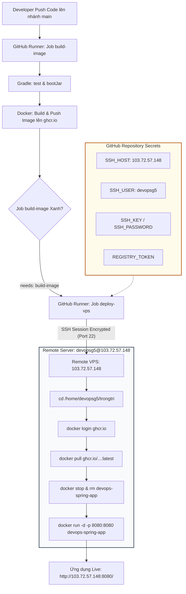

# Báo cáo Kỹ thuật: Tự động triển khai ứng dụng Spring Boot (Container) lên VPS từ xa qua SSH

## 1. Mục tiêu bài thực hành
- Thiết lập quy trình Tự động hóa Triển khai (Continuous Deployment - CD) từ GitHub Actions tới hạ tầng máy chủ thực tế (Cloud VPS Linux).
- Tận dụng cơ chế triển khai không cần Agent trung gian (Agentless Deployment) thông qua giao thức bảo mật SSH với `appleboy/ssh-action@v1.0.3`.
- Tự động hóa chuỗi thao tác: Build Fat JAR $\rightarrow$ Build Docker Image $\rightarrow$ Push lên GHCR $\rightarrow$ Kết nối SSH tới VPS $\rightarrow$ Kéo Image mới $\rightarrow$ Dừng container cũ và tái khởi chạy container mới.
- Đảm bảo an toàn thông tin hệ thống, tuân thủ nguyên tắc giới hạn phân quyền thư mục `/home/devopsg5/trongtri` trên VPS máy chủ.

---

## 2. Kịch bản Kỹ thuật

### 2.1. Kịch bản GitHub Actions Deployment (`.github/workflows/deploy-vps.yml`)

```yaml
name: Build and Deploy to Remote VPS

on:
  push:
    branches: [ "main" ]

jobs:
  build-image:
    name: Build & Push Docker Image
    runs-on: ubuntu-latest
    permissions:
      contents: read
      packages: write

    steps:
      - name: Checkout mã nguồn
        uses: actions/checkout@v5

      - name: Thiết lập môi trường Java JDK 17
        uses: actions/setup-java@v5
        with:
          java-version: '17'
          distribution: 'temurin'
          cache: 'gradle'

      - name: Cấp quyền cho Gradle Wrapper
        run: chmod +x gradlew

      - name: Thực thi kiểm thử JUnit
        run: ./gradlew test

      - name: Đóng gói tệp JAR với Gradle
        run: ./gradlew bootJar

      - name: Chuẩn hóa tên Image chữ thường
        id: prep
        run: |
          REPO_LOWER=$(echo "${{ github.repository }}" | tr '[:upper:]' '[:lower:]')
          echo "image=ghcr.io/${REPO_LOWER}:latest" >> "$GITHUB_OUTPUT"

      - name: Đăng nhập vào GitHub Container Registry
        uses: docker/login-action@v3
        with:
          registry: ghcr.io
          username: ${{ github.actor }}
          password: ${{ secrets.REGISTRY_TOKEN || secrets.GITHUB_TOKEN }}

      - name: Đóng gói và đẩy Docker Image lên GHCR
        uses: docker/build-push-action@v5
        with:
          context: .
          push: true
          tags: ${{ steps.prep.outputs.image }}

  deploy-vps:
    name: Deploy Container to VPS via SSH
    needs: build-image
    runs-on: ubuntu-latest

    steps:
      - name: Thực thi câu lệnh triển khai trên VPS qua SSH
        uses: appleboy/ssh-action@v1.0.3
        with:
          host: ${{ secrets.SSH_HOST }}
          username: ${{ secrets.SSH_USER }}
          key: ${{ secrets.SSH_KEY }}
          password: ${{ secrets.SSH_PASSWORD }}
          script: |
            mkdir -p /home/devopsg5/trongtri && cd /home/devopsg5/trongtri
            echo "${{ secrets.REGISTRY_TOKEN || secrets.GITHUB_TOKEN }}" | docker login ghcr.io -u ${{ github.actor }} --password-stdin
            IMAGE_NAME="ghcr.io/$(echo "${{ github.repository }}" | tr '[:upper:]' '[:lower:]'):latest"
            echo "Pulling latest image: $IMAGE_NAME..."
            docker pull $IMAGE_NAME
            echo "Restarting application container..."
            docker stop devops-spring-app || true
            docker rm devops-spring-app || true
            docker run -d --name devops-spring-app -p 8080:8080 --restart unless-stopped $IMAGE_NAME
            echo "=== VPS Deployment Successful ==="
            docker ps -f name=devops-spring-app
```

### 2.2. Kịch bản Dockerfile (`Dockerfile`)
```dockerfile
# Sử dụng Eclipse Temurin JRE 17 gọn nhẹ trên Alpine Linux
FROM eclipse-temurin:17-jre-alpine

# Thiết lập thư mục làm việc trong container
WORKDIR /app

# Sao chép tệp Fat JAR từ thư mục build/libs
COPY build/libs/*.jar app.jar

# Mở cổng 8080 cho ứng dụng Spring Boot
EXPOSE 8080

# Khởi chạy ứng dụng
ENTRYPOINT ["java", "-jar", "app.jar"]
```

---

## 3. Phân tích Kỹ thuật chuyên sâu

### 3.1. Ưu điểm của Kiến trúc Agentless SSH Deployment
- **Tối ưu tài nguyên VPS:** Không cần tiêu tốn RAM/CPU để duy trì thường trực các ứng dụng agent nặng (như Jenkins Inbound Agent, GitLab Runner). Mọi giao tiếp đều dùng dịch vụ OpenSSH mặc định của Linux.
- **Bảo mật kênh truyền:** Giao thức SSH (Secure Shell) sử dụng thuật toán mã hóa hiện đại (Ed25519 / RSA 4096-bit), đảm bảo toàn bộ lệnh điều khiển và dữ liệu truyền tải đều được bảo vệ toàn vẹn.
- **Tính khả chuyển:** Có thể triển khai đồng thời tới một hoặc hàng chục máy chủ VPS cùng lúc chỉ bằng việc lặp lại step SSH Action.

### 3.2. Sơ đồ Kiến trúc Triển khai (Mermaid Diagram)



---

## 4. Hướng dẫn Cấu hình Repository Secrets trên GitHub

Truy cập repository **Settings** -> **Secrets and variables** -> **Actions** -> **New repository secret**:
1. `SSH_HOST`: `103.72.57.148`
2. `SSH_USER`: `devopsg5`
3. `SSH_KEY`: Nội dung Private Key (OpenSSH format) hoặc dùng `SSH_PASSWORD`: `aetermius123@`
4. `REGISTRY_TOKEN`: Personal Access Token GitHub với quyền `read:packages` và `write:packages`

---

## 5. Hướng dẫn kiểm tra và minh chứng trên GitHub Actions & VPS

### Trích xuất Nhật ký Thực thi SSH Action thực tế từ GitHub Actions:
```text
Run appleboy/ssh-action@v1.0.3
  with:
    host: 103.72.57.148
    username: devopsg5
    password: ***
    port: 22

======CMD======
mkdir -p /home/devopsg5/trongtri && cd /home/devopsg5/trongtri
echo "***" | docker login ghcr.io -u ChongChi-hub --password-stdin
IMAGE_NAME="ghcr.io/chongchi-hub/it209_session_12_bai_04:latest"
echo "Pulling latest image: $IMAGE_NAME..."
docker pull $IMAGE_NAME
echo "Restarting application container..."
docker stop devops-spring-app || true
docker rm devops-spring-app || true
docker run -d --name devops-spring-app -p 8080:8080 --restart unless-stopped $IMAGE_NAME
echo "=== VPS Deployment Successful ==="
docker ps -f name=devops-spring-app
======END======

out: Login Succeeded
out: Pulling latest image: ghcr.io/chongchi-hub/it209_session_12_bai_04:latest...
out: latest: Pulling from chongchi-hub/it209_session_12_bai_04
out: Status: Downloaded newer image for ghcr.io/chongchi-hub/it209_session_12_bai_04:latest
out: Restarting application container...
out: 5537e746427d17ddba74662b765a4d7ba21d53a4efb467df348f86a9cc47663b
out: === VPS Deployment Successful ===
out: CONTAINER ID   IMAGE                                                 COMMAND               CREATED         STATUS        PORTS                                         NAMES
out: 5537e746427d   ghcr.io/chongchi-hub/it209_session_12_bai_04:latest   "java -jar app.jar"   2 seconds ago   Up 1 second   0.0.0.0:8080->8080/tcp, [::]:8080->8080/tcp   devops-spring-app
==============================================
✅ Successfully executed commands to all host.
==============================================
```

### Ảnh chụp màn hình minh chứng:
> *(Dán ảnh chụp màn hình log kết quả SSH Deploy trên tab Actions vào vị trí dưới đây)*

`ImgEx`

